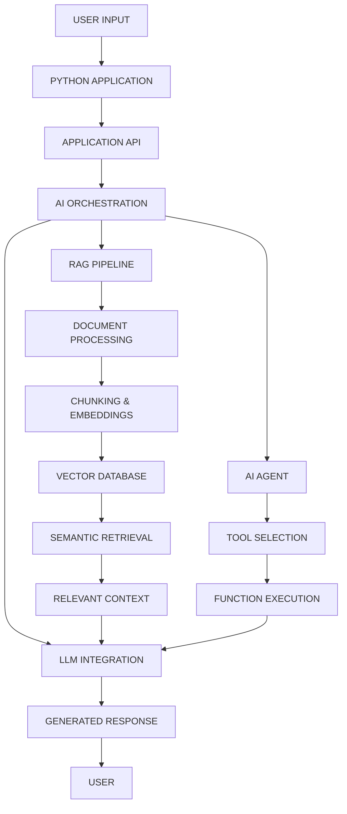

# AI Engineering Journey

  <b>Learning. Building. Engineering AI Systems.</b>

  A hands-on journey into Artificial Intelligence, LLM applications, Retrieval-Augmented Generation, and AI Agent development.

  <a href="https://github.com/Tuberamesh">GitHub</a> •
  <a href="https://www.linkedin.com/in/ramesha-g/">LinkedIn</a> •
  <a href="https://youtube.com/@The_Decoder_yt">YouTube</a> •
  <a href="https://instagram.com/decoder_space">Instagram</a>

---

## 01 / Overview

I'm a Data Science undergraduate exploring the engineering behind intelligent applications.

This repository documents my practical journey of understanding how modern AI systems work — from Python-based applications and LLM integrations to semantic search, RAG pipelines, and autonomous AI agents.

Rather than focusing only on theory, I learn by building, experimenting, debugging, and documenting working implementations.

**The focus is simple: understand the technology, build with it, and develop the engineering skills to create useful AI applications.**

---

## 02 / Technical Stack

### Programming & Development
`Python` `SQL` `JSON` `Bash` `Git` `GitHub`

### AI & Generative AI
`Artificial Intelligence` `Generative AI` `Large Language Models` `LLM APIs` `Ollama` `Prompt Engineering` `Context Engineering`

### Knowledge & Retrieval
`Embeddings` `Semantic Search` `Vector Databases` `ChromaDB` `RAG` `Document Processing` `PyMuPDF`

### AI Agents
`AI Agents` `Tool Calling` `Function Calling` `Agent Loops` `LLM Tool Integration`

### Application Engineering
`REST APIs` `FastAPI` `HTTP` `API Integration` `Request/Response Handling` `Pydantic`

### Python Ecosystem
`Pandas` `NumPy` `Sentence Transformers` `Requests` `Virtual Environments`

---

## 03 / System Architecture

Understanding how individual technologies connect is an essential part of AI Engineering.

The following illustrates the core components I've been exploring and integrating into AI applications.

---

## 04 / Engineering Domains

| Domain | Areas of Exploration |
|---|---|
| LLM Engineering | Model integration, tokens, context windows, structured outputs |
| Context Engineering | Prompt design, context management, prompt injection |
| Retrieval Systems | Chunking, embeddings, similarity search, retrieval quality |
| RAG Engineering | Document ingestion, vector retrieval, grounded generation, citations |
| Agent Engineering | Tool selection, function calling, execution loops |
| Backend Engineering | FastAPI, REST endpoints, validation, error handling |

---

## 05 / Selected Implementations

A collection of practical implementations developed while exploring AI engineering concepts.

| Project | Focus |
|---|---|
| Semantic Search Engine | Embeddings, vector similarity, document retrieval |
| Personal Knowledge Search | PDF ingestion, chunking, ChromaDB, semantic retrieval |
| RAG Application | Document-based question answering with retrieved context |
| FastAPI AI Backend | API endpoints for AI-powered applications |
| Calculator Agent | LLM tool selection and Python function execution |

Each implementation focuses on understanding the underlying architecture, not simply getting the code to run.

---

## 06 / Engineering Principles

The principles guiding how I approach building AI applications:

- **Understand before integrating** — know what happens behind the abstractions.
- **Build modular systems** — separate responsibilities and keep implementations maintainable.
- **Ground AI responses** — use relevant context and retrieval to improve reliability.
- **Validate outputs** — handle errors, unexpected inputs, and model limitations.
- **Experiment continuously** — test different approaches and understand their trade-offs.
- **Document the process** — make implementations understandable and reproducible.

---

## 07 / Beyond the Code

I'm also a technology content creator behind **Decoder Space**, where I share practical insights about technology, AI tools, development, and the learning experiences of an engineering student.

I believe technical knowledge becomes more valuable when it can be understood, applied, and shared with others.

**Build systems. Explore ideas. Share what you learn.**

---

## 08 / Connect

I'm open to connecting with developers, AI enthusiasts, engineering students, and people building interesting products.

**Interested in:** AI Engineering · Generative AI · LLM Applications · RAG · AI Agents · Data Science

  <a href="https://www.linkedin.com/in/ramesha-g/"><b>LinkedIn</b></a> &nbsp; • &nbsp;
  <a href="https://github.com/Tuberamesh"><b>GitHub</b></a> &nbsp; • &nbsp;
  <a href="https://youtube.com/@The_Decoder_yt"><b>YouTube</b></a> &nbsp; • &nbsp;
  <a href="https://instagram.com/decoder_space"><b>Instagram</b></a> &nbsp; • &nbsp;
  <a href="mailto:YOUR_EMAIL"><b>Email</b></a>

  AI Engineering · Systems Development · Continuous Learning

  <b>Building beyond the basics.</b>

